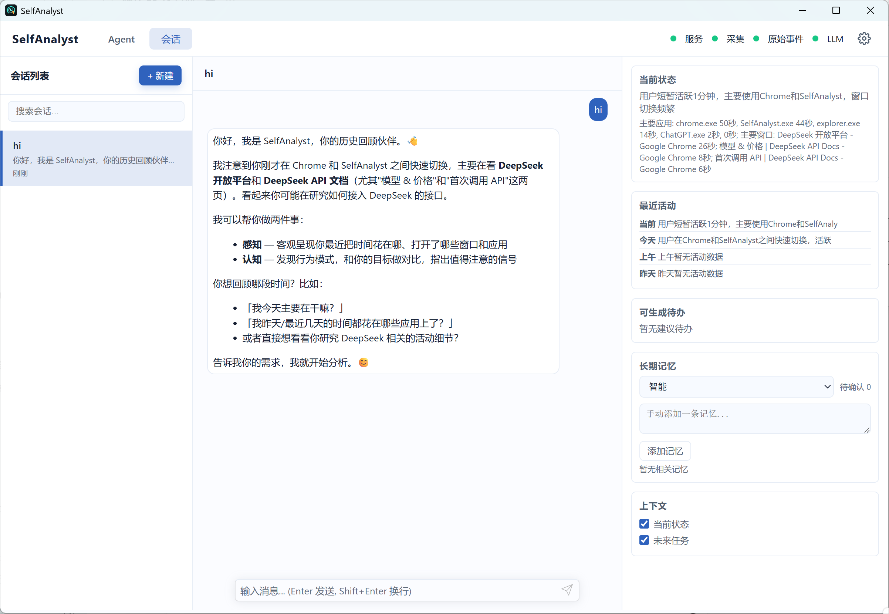

# SelfAnalyst

[English](README.md) | **简体中文**

[官网](https://chunleik.github.io/self-analyst/zh-CN/) · [下载](https://github.com/chunleik/self-analyst/releases)

SelfAnalyst 是一个本地优先的个人活动分析工具。它记录前台应用、窗口标题和活动时间，
帮助你回顾一天的工作；配置大模型后，还可以总结活动、归纳工作内容，并通过对话继续追问。



## 快速开始

当前提供 **Windows 10/11** 桌面版，尚未提供 macOS 安装包。

1. 前往 [GitHub Releases](https://github.com/chunleik/self-analyst/releases)，下载安装包或免安装 ZIP。
2. 完成安装，或解压 ZIP 后运行 `SelfAnalyst.exe`。发布包自带 Java 运行环境，无需安装开发工具。
3. 打开右上角配置入口，在“模型设置”中配置 **API Key** 连接，或选择 **ChatGPT 登录**（预览），在 OpenAI 浏览器页面授权账户并选择模型，再点击“保存并应用”。详见[模型设置指南](docs/llm-settings.md)。
4. 在“看板”回顾活动，在“会话”中提问，例如“今天主要做了哪些工作？”。

使用须知：

- 未配置模型时也能启动本地服务；聊天和模型摘要需要可用的模型连接。
- ChatGPT 登录需要 OpenAI 开放所需预览、账户符合资格并授予直接模型访问权限。订阅不等于 API 额度，也不保证可用；登录成功不代表模型能生成。可选生成测试会消耗服务端用量；本地自动化测试不能证明真实账户可用。
- 关闭窗口后应用继续在系统托盘运行；完全退出请使用托盘菜单。
- 运行数据保存在 `%LOCALAPPDATA%\com.selfanalyst.desktop`，升级后继续使用。便携模式、备份与恢复见[运行数据指南](docs/runtime-storage.md)。

## 主要功能

日或半天摘要等待其他时段时，看板会完整展示已完成的子时段摘要，并标注“部分摘要”。展开可查看未完成时段、失败原因、用量与重试时间；没有可用子摘要时标注“仅应用统计”，完整摘要就绪后自动替换。

已结束的小时、半天或全天摘要失败或周期额度耗尽时，可在对应时段旁点击**对话修复**。“昨天”被下级阻塞时，折叠卡片也会显示带准确时段的**修复下级摘要**按钮。半天和全天修复使用已完成子摘要；下级未完成时先修复下级。预览并编辑结构化草稿，逐项确认用户补充事实，经本地校验后明确保存；用户确认内容始终标为自述来源，活动统计与累计模型消耗不变。没有模型或额度用尽时仍能本地编辑、校验和保存。上级按正常调度恢复；上级自身耗尽时，在下级齐备后也可本地修复。详见[修复指南](docs/summary-repair.md)。

**升级前请先备份：**此功能将 Wiki 数据库迁移到 schema 5，旧版不能打开迁移后的数据库。降级必须使用兼容的升级前备份，不得手工降低数据库版本。详见[备份与恢复](docs/runtime-storage.md)。

- **活动回顾**：通过看板时间轴查看当前、今天和历史活动。已有概览无需展开即可完整阅读，主题标题放在下方；展开可按原顺序阅读各主题完整标题与叙述，空证据区块自动隐藏，并可带着条目上下文继续追问。本地降级摘要与已有概览使用一致文字样式；展开条目在自动刷新后保持展开，主动点击才收起，统计日期或时区切换时重置阅读状态。统计日为本地时间 04:00 至次日 04:00，详见[活动统计说明](docs/activity-statistics.md)。
- **个人知识**：在“知识”中把跨日期、跨应用的活动关联到稳定的项目、主题和目标；确认、移除或改正关联，你的决定在重建和重启后保留。知识在本地工作，不额外调用模型。详见[个人知识指南](docs/personal-ontology.md)。
- **可选 Neo4j 同步**：将当前已纠错的知识图谱手工发送到你配置的 Neo4j 数据库。默认关闭，每次同步都需确认目标、命名空间和发送范围，本地存储仍为权威。详见[配置与只读查询指南](docs/neo4j-sync.md)。
- **图片提问**：在会话中选择或粘贴 PNG/JPEG 图片，交给支持图片输入的模型分析；每轮最多 4 张，每张不超过 5 MiB 和 2000 万像素。不启用后台截屏。
- **生成文件**：让助手生成表格、文档、演示文稿或 HTML/SVG，通过会话文件卡片保存或下载。详见[文档生成指南](docs/document-generation.md)。
- **连接与工具**：支持 HTTPS Streamable HTTP MCP 的工具审阅与逐次确认，以及内置 QQ/163 只读邮箱。新邮箱账户默认选择全部 IMAP 文件夹，包含以后新增及嵌套目录；旧账户范围保持不变，需主动编辑。账户和正文读取仍默认关闭。邮箱通过明确确认的启用操作，将授权码保存到 Windows 系统凭据库；安全持久化不可用时不回退明文或仅会话。该操作取代单独的邮箱授权、启用和存储三个勾选项，范围与正文权限保持独立。邮箱数据仍需模型接收目标授权，并可能保留在聊天中；邮箱来源会话不自动提炼长期记忆。参见[连接指南](docs/integrations.md)和[邮箱指南](docs/mail-integration.md)。
- **长期记忆**：自动保存有长期价值的信息，过滤凭据、敏感推断和一次性操作流水；可以在会话中要求更正或忘记。
- **帮助与更新**：“帮助”菜单提供使用指南、“帮助文档”、“个人知识指南”、反馈问题、“检查更新”和“项目官网”（GitHub 仓库，桌面版通过系统默认浏览器打开）。仅在手动操作时检查，不自动下载或安装更新。“关于 SelfAnalyst”显示当前桌面版本及精确对应版本（含 beta）的发布时间，并按本地时区展示。可用时使用已缓存的公开信息；若无法取得时间且没有同版本缓存，则显示暂不可用，debug 构建标明开发版。
- **界面语言**：提供中文和 English，默认跟随系统语言。可在设置中选择，或配置 `app.language`（`auto`、`zh` 或 `en`），重启应用后生效。

## 隐私与数据边界

活动数据保存在本机，调用模型时只将所需输入发送到你配置的服务端。可选 Neo4j 同步仅在明确确认后，
将有界知识图谱快照发送到你指定的数据库；其中可能包含私密标题、描述和证据。详见[隐私说明](PRIVACY.md)。

- 内容事件只保存白名单内的标题字段，不保存正文、UIA 文本、控件树、截图、OCR 或音频。
- UIA 查询失败时退回系统窗口标题；敏感应用会跳过 UIA 查询。
- 文件采集仅限你配置的目录内的文件系统元数据（文件名、路径、大小和时间）；除安全解析 `.gitignore` 外，不读取文件正文，不计算内容哈希，也不生成摘要、主题或向量。
- 标题送入模型前，会隐藏内网 IPv4 地址、会议号和账号验证页，并跳过带私人浏览标记的标题。没有任何标记的无痕窗口无法识别，请在**设置 → 隐私**中添加敏感应用和网站。
- 每个应用支持两种模式：**不采集**停止该应用新的窗口/内容事件及 UIA 查询；**仅对模型隐藏**保留本地记录，但从新的模型输入中排除匹配事件。两种模式都会从新的模型查询、摘要、修复请求及生成文档所用的事件投影中隐藏匹配的历史事件。本机展示和 AFK 采集不变，不采集期间的记录之后无法补回。
- 在应用内保存后（包括 TOML 原文编辑器），隐私规则立即生效；不会删除已有记录、改写已有摘要、旧工具结果或会话中已看到的内容。执行中的模型操作继续使用开始时的策略快照，下一次操作采用已保存的规则。AQL 数值聚合仍可能包含隐藏时长。投影导出报告实际导出的 `recordCount` 与 `privacyFilteredCount`，`complete: true` 表示过滤后的投影已完整生成。
- Agent 的 AQL 查询禁止通过 `tag` 覆盖 `app`、`title`、`context_title`、`url_host` 或 `private_browsing`，避免绕过隐私过滤；其他自定义标签和本机直接 AQL 查询不受影响。
- 事件库保存合并后的活动区间，是权威数据，需要定期备份。磁盘低于阻断阈值时停止新采集，不会自动删除历史活动。
- 保存 Neo4j 配置和查询状态都不会连接 Neo4j。关闭同步不会删除远端副本；来源删除仅在下次成功手工同步后反映到远端。更换命名空间会保留旧命名空间。
- ChatGPT OAuth 凭据与 TOML 分开，使用仅当前用户的文件权限保护，没有应用层加密，也不是系统凭据保险库；同一操作系统账户下的进程仍可读取。断开时清除本地令牌并尝试远端撤销，未确认撤销时明确提示；独立 API Key 和会话历史保留。

## 配置

配置窗口分为六个页签：**模型设置**（一个活动 API Key 或 ChatGPT 连接，支持模型发现和生成测试）、
**隐私**（应用模式和隐藏网站）、**高级配置**（TOML 原文编辑）、**运行数据**（目录、存储占用和迁移备份清理）、
**Neo4j 同步**（可选、每次手工确认的图谱分享）和 **连接与工具**（远端 MCP 与只读邮箱）。模型设置仍为默认入口。

在**隐私**中搜索最近使用的应用或手工输入可执行文件名，选择模式后保存。候选来自最近 30 天的本机窗口活动，
按时长排序，最多显示 100 个；候选读取失败时仍可手工添加。应用按完整可执行文件名匹配，不区分大小写；
`PotPlayerMini.exe` 和 `PotPlayerMini64.exe` 等变体需分别添加。网站条目对模型隐藏匹配的标题、上下文标题或主机名，
不会停止浏览器采集。

对应配置键为 `events.collection.excludeApps`（**不采集**）、`wiki.privacy.excludeApps`（**仅对模型隐藏**）
及 `wiki.privacy.excludeSites`（隐藏网站）。三个键默认均为空，支持逗号或分号分隔，Agent 配置工具不可写入。
模型策略合并两份应用清单；同一应用在两份清单中重复时，隐私页显示为**不采集**。
三个键在应用内成功保存后均无需重启。

显式 TOML 配置优先于环境变量，环境变量优先于默认值。`llm.api-key`、`llm.base-url`、`llm.model`、
`llm.temperature`、`llm.provider`、`llm.chatgpt-account` 和 `llm.chatgpt-model` 修改后无需重启，
新聊天和摘要任务即采用新配置。ChatGPT 单独选择账户和模型，不使用 API Key 连接的地址或温度。
Embedding 仍使用独立的 API Key 连接，可沿用既有 `llm.api-key` 继承规则，不接收 OAuth 令牌，也不会因切换连接而启用。
保存的 `neo4j.*` 设置在下次手工同步时生效，
无需重启，也不会自动发送数据；其他需重启的键会在设置中标明。
外部修改 TOML 文件不会自动应用，需要在应用内保存或重启后端。

| 配置键 | 环境变量 | 默认值 |
|--------|----------|--------|
| `llm.base-url` | `LLM_BASE_URL` | `https://api.openai.com/v1` |
| `llm.model` | `LLM_MODEL` | `gpt-4o` |
| `llm.api-key` | `OPENAI_API_KEY` | 空 |
| `llm.provider` | —（仅 `config.toml`） | `api-key`；也可选 `chatgpt` |
| `llm.chatgpt-account` | —（仅 `config.toml`） | 空；所选已授权账户 ID |
| `llm.chatgpt-model` | —（仅 `config.toml`） | 空；选择可用模型或手工输入 ID |
| `events.mode` | `EVENTS_MODE` | `embedded` |
| `events.port` | —（仅 `config.toml`） | `5700` |
| `events.collection.excludeApps` | —（仅 `config.toml`） | 空 |
| `wiki.privacy.excludeApps` | —（仅 `config.toml`） | 空 |
| `wiki.privacy.excludeSites` | —（仅 `config.toml`） | 空 |
| `neo4j.enabled` | —（仅 `config.toml`） | `false` |
| `neo4j.uri` | —（仅 `config.toml`） | 空 |
| `neo4j.database` | —（仅 `config.toml`） | `neo4j` |
| `neo4j.username` | —（仅 `config.toml`） | `neo4j` |
| `neo4j.password-env` | 指定密码环境变量的名称，不是密码值 | `SELF_ANALYST_NEO4J_PASSWORD` |
| `neo4j.namespace` | —（仅 `config.toml`） | 空；必填且由一个本地数据集独占 |
| `neo4j.timeout-seconds` | —（仅 `config.toml`） | `15`（范围 `1`–`120`） |

使用 Neo4j 前，在应用启动时继承的环境中设置密码，切勿把密码写入 TOML 或 URI；更改进程环境后需重启应用。
明文连接仅允许 `localhost`、`127.0.0.1` 或 `[::1]` 上的 `bolt://`；远端必须使用
`bolt+s://` 或 `neo4j+s://` 和有效、受信任 CA 签发的证书。禁止明文 `neo4j://`、`+ssc`、嵌入凭据、
路径（包括末尾斜杠）、查询参数和片段。为本地数据集选择独占命名空间，在“配置 → Neo4j 同步”
核对发送范围及目标，再点击“确认并同步…”。目标账号需要图数据写入、创建约束和 `SHOW CONSTRAINTS` 的权限；
详细配置与安全 Cypher 示例见 [Neo4j 指南](docs/neo4j-sync.md)。

完整键表见[模型设置指南](docs/llm-settings.md)和[用户配置规格](openspec/specs/user-configuration/spec.md)，
摘要预算与限制见[架构文档](docs/architecture.md)。

## 开发

环境要求：JDK 21、Maven 3.9+、Node.js 20+（桌面端开发）、Rust stable 与 Cargo（Tauri 壳和
accessibility sidecar），以及 Windows 10/11（完整桌面体验）。

```powershell
mvn test                                                        # JUnit 与桌面 UI 测试
mvn package -DskipTests                                         # 构建 JAR
cargo test --manifest-path self-analyst-axsidecar/Cargo.toml    # Rust 边车测试

Set-Location self-analyst-desktop; pnpm install; pnpm tauri dev # 运行桌面壳

.\scripts\build-dist.ps1                                        # 本机发布目录
.\scripts\build-portable.ps1                                    # 包含 jlink JRE 的便携 ZIP
.\scripts\build-installer.ps1                                   # NSIS 安装包
```

构建输出位于 `artifacts/`，并为 ZIP 和安装包生成 `.sha256` 文件。

| 模块 | 职责 |
|------|------|
| `self-analyst-events` | 嵌入式事件服务、事件策略和历史迁移 |
| `self-analyst-content` | 前台窗口、UIA 临时查询和上下文标题提取 |
| `self-analyst-file` | 用户显式配置目录中的文件系统元数据 |
| `self-analyst-wiki` | 标题事实的时间聚合、摘要和索引 |
| `self-analyst-ontology` | 类型化实体、带证据的关系、用户纠错与本地知识查询 |
| `self-analyst-app` | 启动编排、Agent、桌面 API/UI |
| `self-analyst-axsidecar` | Windows UIAutomation Rust 边车 |
| `self-analyst-desktop` | Tauri 桌面壳 |

## 文档

- [文档与规格索引](docs/README.md)
- [架构](docs/architecture.md)
- [可选 Neo4j 同步与只读查询](docs/neo4j-sync.md)
- [MCP 连接与 QQ/163 只读邮箱](docs/integrations.md)
- [测试与集成验证](docs/testing.md)
- [摘要质量评测](docs/summary-quality-evaluation.md)
- [官网预览与发布说明](docs/website.md)
- [0.6.0 发布说明](docs/releases/v0.6.0.md)

## 贡献

欢迎提交缺陷报告、功能建议和 PR。本项目采用规格驱动开发，行为契约以 `openspec/specs/` 为权威来源。
动手前请先阅读[贡献指南](CONTRIBUTING.md)和[行为准则](CODE_OF_CONDUCT.md)。
安全漏洞请勿开公开 Issue，请按[安全策略](SECURITY.md)私密报告。

## 许可证

本项目采用 [Apache License 2.0](LICENSE)，另见 [NOTICE](NOTICE) 和
[THIRD-PARTY-NOTICES.md](THIRD-PARTY-NOTICES.md)。
